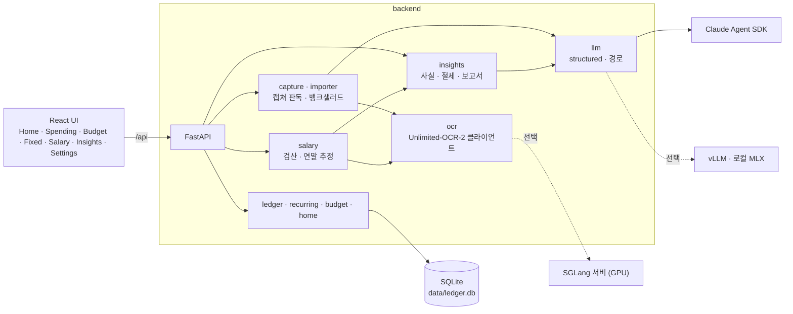

# Mallot Ledger

개인 자산관리 앱 Mallot 의 **가계부 기능만 떼어 내** 독립 실행되게 정리한 앱. 투자 쪽은 [Mallot Invest Agent](https://github.com/derf1a/Mallot-Invest-Agent) 로 따로 있다.

- **월급날 기준 한 달** — 수입일(예: 25일)부터 다음 수입일 전날까지를 한 기간으로 본다. 고정비 · 변동비 · 저금이 그 안에서 나뉜다.
- **숫자는 코드, 해석은 LLM** — 합계 · 검산 · 세금 추정은 모두 코드가 계산한다. LLM 은 캡쳐 판독과 번호 붙은 사실만 근거로 하는 보고서에만 쓴다.
- **캡쳐로 입력** — 카드 · 은행 앱 스크린샷이나 급여명세서를 올리면 OCR(Unlimited-OCR-2) 또는 Vision LLM 이 칸을 채운다. 저장 전에 고친다.

> 내 거래 · 급여가 들어가는 앱이다. 이 저장소에는 코드만 있고 DB · `.env` · 내보내기 파일은 들어가지 않는다 (`scripts/check-secrets.sh` 가 커밋을 막는다).

## 무엇을 하나

| 화면 | 내용 |
|---|---|
| **Home** | 이번 달 남은 변동비(큰 숫자 + 누적 곡선) · **지출 캘린더와 지출 내역**(날을 누르면 그날 거래) · 주수입 배분 · 변동비 예산 · 고정비 출금일 · 최근 6개 기간 · 급여 · 소비 습관 |
| **Spending** | 월간 지출 내역(변동비 · 개인 사용) — 캘린더 · 검색 · 분류 · 캡쳐 입력, 가맹점 분류 규칙 학습 |
| **Budget** | 변동비 카테고리 예산 — 할당 가능액, 지난 기간 · 최근 3개 기간 평균, 카테고리를 펼쳐 이번 기간 거래 · 재분류 |
| **Fixed** | 월간 고정비 — 저금 · 보험 · 구독 · 통신 같은 칸과 항목, 출금 자동 매칭, 미리 나간 결제 · 건너뛰기, 반복 지출 자동 탐지 |
| **Salary** | 급여명세서 기록(직접 · 이미지) → 2026 요율로 4대보험 · 지방소득세 검산, 실지급액 검산, 가계부 입금 확인, 달마다 흐름, 실효 세율, **연말정산 환급 · 추가 납부 추정** |
| **Insights** | 소비 습관 분석 — 기간별 카테고리 · 요일 · 시간대 · 많이 쓴 곳, 고정비 계획 vs 실제, 올해 절세(카드 · 연금저축 · 청약 공제 추정), LLM 보고서(사실 번호 검증) |
| **Settings** | 개인설정 · 내 계좌 · 카테고리 · 가맹점 규칙 · **뱅크샐러드 가져오기** · 판독 기록 · DB 백업 · **OCR** · LLM 경로 · 공유 |

## 구조



자세한 모듈 지도는 [docs/architecture.md](docs/architecture.md), OCR 은 [docs/ocr.md](docs/ocr.md), 인터넷에 열기 · 휴대폰 · 손님은 [docs/share.md](docs/share.md).

## 실행

```bash
make install                     # uv · npm 의존성 + 커밋 훅
cp .env.example .env             # LLM 키 · OCR 서버 주소 (선택)
make dev                         # 백엔드 :8200 + 프론트 :3200
```

| 명령 | 내용 |
|---|---|
| `make dev` | 개발 모드 (Mallot Invest 8100 · 3100 과 같이 띄워도 겹치지 않음) |
| `make serve` | 프론트 빌드 → 백엔드 하나로 :8200 |
| `make share` | 로그인 필수 서버 + Cloudflare 터널 (휴대폰 · 손님 링크) |
| `make admin-password` | 관리자 비밀번호 (.env 에 scrypt 해시) |
| `make import-mallot DB=…/wt.db` | Mallot DB 의 가계부 데이터를 옮긴다 (`ARGS=--images` 면 캡쳐 이미지도) |
| `make import FILE=…xlsx` | 뱅크샐러드 가계부 내보내기 가져오기 (화면: Settings > 데이터 · 가져오기) |
| `make eval ARGS="--via ocr"` | 확인된 캡쳐 판독을 다시 읽어 정확도 비교 |
| `make test` | 비밀값 검사 + pytest + 프론트 린트 · 타입 · 빌드 |

## 입력 방식

1. **직접 입력** — 날짜 · 금액 · 가맹점 · 카테고리 · 결제수단.
2. **캡쳐 이미지** — 뱅크샐러드 · 카드사 앱 · 결제 완료 화면. 판독 → 확인 · 수정 → 저장. 판독 기록이 남아 정확도를 잰다.
3. **뱅크샐러드 내보내기** — xlsx/zip 을 올리면 미리보기 → 가져오기 (결제 취소 상쇄, 되돌리기).
4. **급여명세서** — 직접 또는 이미지.

금융 마이데이터 API 는 사업자 허가가 있어야 해서 쓰지 않는다.

## 라이선스 · 주의

개인 프로젝트. 세금 · 보험료 계산은 2026년 기준의 단순화한 추정이고 세무 조언이 아니다.
