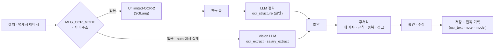

# 구조

```text
backend/            Python 3.12 · uv · FastAPI
  app/main.py       앱 조립: 시작 시 .env · 마이그레이션 · 멈춘 실행 정리 · 정기지출 재매칭, 기능 자동 등록, 빌드된 화면 서빙
  app/registry.py   기능 패키지 자동 등록 — api*.py 의 router, jobs 의 작업, service.py
  app/core/         공용: db(연결 · merchant_key SQL 함수 · 마이그레이션 실행) · migrations · envfile · periods(수입일 기준 한 달) · net · metrics · trace · access · base_path(경로 접두사 MLG_BASE_PATH 떼기)
  app/llm/          structured · agentic 단일 진입점 + 사용량 기록, 경로(routes: 기능 → Claude · MLX · vLLM)
  app/runs/         작업 실행기 (소비 습관 보고서 · 판독 재평가)
  app/auth/         관리자 로그인 · 손님 공유 링크 · 요청마다 역할 검사(guard) — 쿠키 mlg_*, 홈 모드면 Mallot 홈에 역할을 묻는다
  app/system/       버전 · DB 정보 · 백업(관리자만)
  app/ledger/       거래 · 요약 · 개인설정 · 내 계좌 · 가맹점 정규화 · 분류 규칙, Mallot DB 옮기기(import_mallot)
  app/recurring/    고정비(정기지출): 칸 · 항목 · 자동 매칭 · 기간 배정 · 건너뛰기 · 반복 지출 탐지
  app/budget/       변동비 예산: 할당 가능액 · 카테고리 예산 · 참고 사용액
  app/home/         홈 추세: 날마다 쓴 변동비 · 최근 6개 기간
  app/insights/     소비 습관: 사실(LLM 없음) · 고정비 · 절세(tax · tax_rules) · 보고서(사실 번호 검증)
  app/salary/       급여: 명세서 기록 · 검산(rules: 2026 요율) · 올해 흐름 · 연말정산 추정(analysis) · 명세서 판독(extract)
  app/capture/      캡쳐 판독: Vision · OCR→LLM 판독기, 파이프라인 · 기록 · 정확도 · 재평가
  app/ocr/          Unlimited-OCR-2 클라이언트 (OpenAI 호환) · 상태 · 시험
  app/importer/     뱅크샐러드 내보내기 가져오기 · 되돌리기
frontend/           React + TypeScript (Vite)
  src/app/          Layout(사이드바 · 모바일 메뉴) · NavIcons · BrandMark
  src/shared/       http(API 주소에 경로 접두사 BASE 붙이기) · otherApp · format · useLoad · charts · readOnly(손님) · ui/
  src/features/     home · ledger · budget · recurring · salary · insights · settings · auth · runs
```

## 판독 흐름



## 급여 → 세금

- 명세서마다: 지급(과세 + 비과세) − 공제 = 실지급액 검산, 정기 급여는 2026 요율(국민연금 4.75% · 건강 3.595% · 장기요양 13.14% · 고용 0.9% · 지방세 10%)로 검산, 지급일 ±3일 같은 금액 수입이 가계부에 있는지.
- 올해: 기록 + 남은 달 × 최근 3달 정기 급여 평균으로 총급여 · 원천징수를 잇는다 (상여는 잇지 않음).
- 연말정산 추정: 결정세액은 Insights 절세 계산(`insights.tax`, 카드 · 연금저축 · 청약 등 가계부로 추정한 공제)을 쓰고, 안 되면 기본 공제만. 절세 계산은 총급여를 안 넣었으면 급여 기록을 쓴다 (서로 부를 때 도는 걸 `with_estimate=False` 로 끊는다).

## 데이터

SQLite 하나(`data/ledger.db`). 스키마 v1 은 공용(설정 · 실행 · LLM 사용량 · 호출 추적) + Mallot 가계부 테이블의 마지막 모양 + `salary_slips` · `extraction_logs.ocr_text/note`.
캡쳐 이미지는 `data/` 아래, 백업은 `data/backups/` (화면의 DB 백업 버튼).
